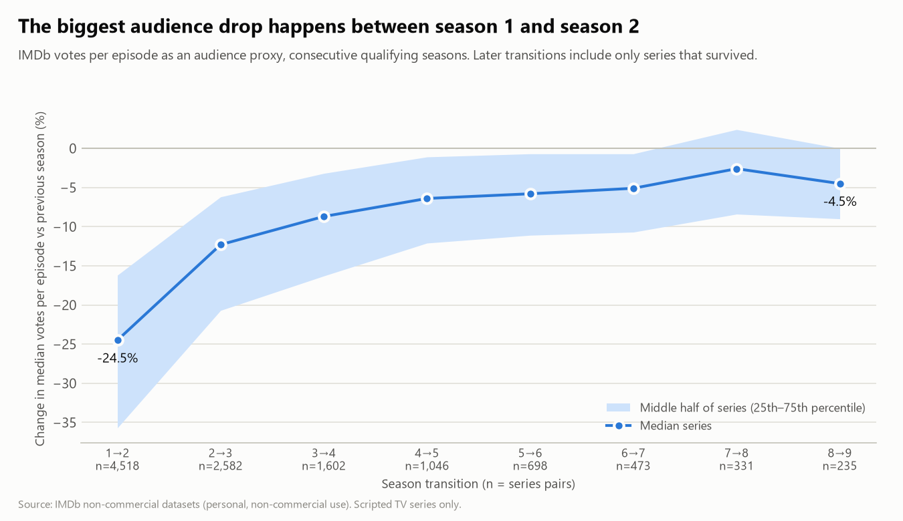
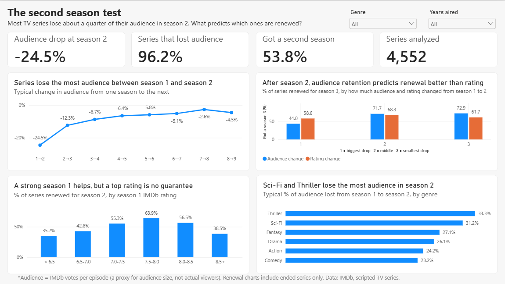
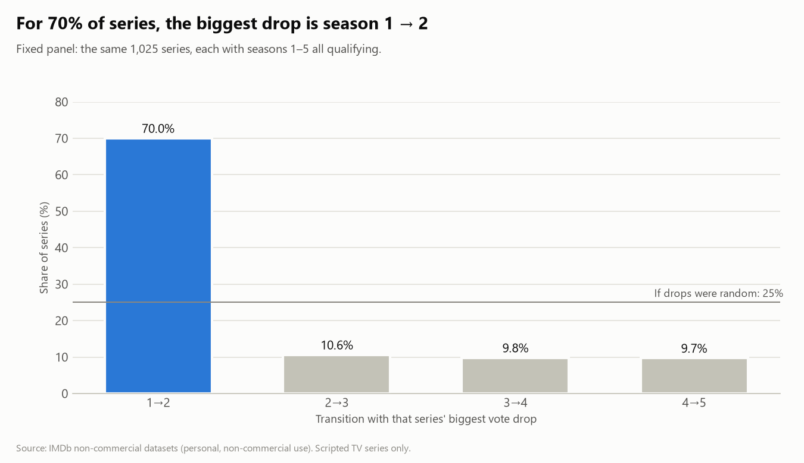
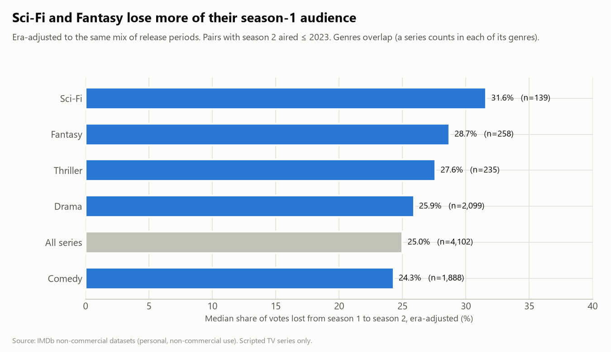
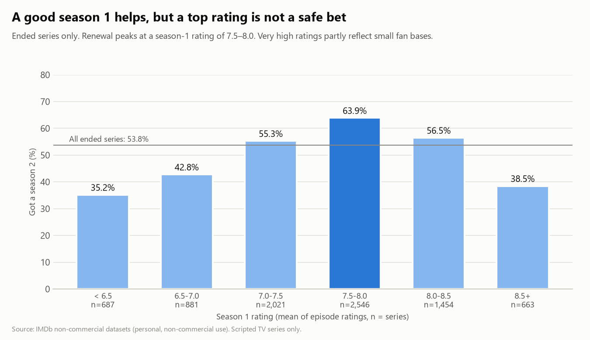
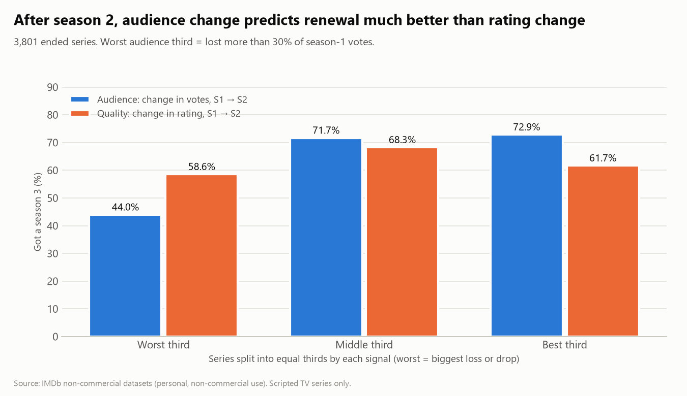

# The Second Season Test: When Should a Streaming Platform Renew a Series?

**A Business Analyst case study on 12M+ IMDb records.** Each TV series is treated as a product and each season as a cohort. IMDb votes per episode serve as an (imperfect) audience proxy and ratings as a quality proxy.

**[View the project website →](https://galva2.github.io/second-season-test/)** A two-minute visual summary of the findings.

## Key findings

1. **Season 2 is where the audience is lost.** The median series loses **24.5%** of its votes per episode from season 1 to season 2, and later seasons lose far less. In a fixed group of 1,025 long-running series, **70%** had their single biggest drop at season 1 → 2 (25% would be expected at random).
2. **Audience change after season 2 predicts renewal much better than rating change.** Among ended series, the third that lost the most audience in season 2 got a season 3 only **44.0%** of the time, against about **72%** for the rest. Rating change moved renewal by **10 points at most**.
3. **A strong season 1 helps, but a top rating is not a safe bet.** Renewal peaks at a season-1 rating of **7.5–8.0 (63.9%)** and falls to **38.5%** at 8.5+, which partly reflects small, enthusiastic fan bases.



## The business question

Leadership at a streaming platform wants data-driven rules for when to invest in, renew or end a series. The analysis answers three questions, all around the second season:

| # | Question | Answer in one line |
|---|---|---|
| Q1 | When is the audience lost, and does it differ by genre? | Season 1 → 2, in every era. Sci-Fi and Fantasy lose more. |
| Q2 | Can the pilot or season 1 already tell us if a series will last? | Partly. Ratings below 7 are a warning sign. Very high ratings are not a guarantee. |
| Q3 | After season 2, should leadership watch the audience or the quality? | The audience. |

## Decision rules (historical benchmarks, not causal effects)

1. **Expect a ~25% audience drop at season 2, and benchmark by genre.** A drop of that size is normal. The median era-adjusted drop is 24.3% for Comedy, 25.9% for Drama, 28.7% for Fantasy and 31.6% for Sci-Fi.
2. **Flag a series for review when season 2 loses more than 30% of its season-1 audience.** Historically, only 44.0% of such series got a season 3, against 71.7–72.9% for the rest. In the streaming era (2019–2025) the gap is wider: 34.1% vs 57.0–66.4%.
3. **Treat a season-1 rating below 7.0 as a warning, and a rating of 8.5+ as a prompt to check audience size.** Renewal was 35.2–42.8% below 7.0, 63.9% at 7.5–8.0, and 38.5% at 8.5+. Series rated 8.5+ had a median of 51 votes per episode, against 115 at 7.5–8.0.

## Power BI dashboard

An interactive one-page dashboard, built in Power BI Desktop from the CSV package in [`outputs/powerbi/`](outputs/powerbi/README.md). It uses a star-schema model (series dimension, season-pair and renewal fact tables, and a genre bridge table) and DAX measures such as `CALCULATE` for the season-2 KPIs. Slicers filter by genre and by the years the seasons aired. Every number was checked against the SQL results.



*Genre values on the dashboard are raw medians. The genre benchmarks in the decision rules above and in Q1 below are adjusted for release period, which is why Sci-Fi ranks first there and Thriller ranks first here.*

## Findings in detail

### Q1. Audience retention: the drop happens at season 2

| Transition | Series pairs | Median vote change | Pairs that lost votes |
|---|---|---|---|
| 1 → 2 | 4,518 | −24.5% | 96.2% |
| 2 → 3 | 2,582 | −12.3% | 89.1% |
| 3 → 4 | 1,602 | −8.7% | 84.1% |
| 4 → 5 | 1,046 | −6.4% | 77.7% |



- **The shape holds in every era. The size does not.** At 1 → 2, the median drop was −19.7% for seasons aired up to 2012, −24.4% for 2013–2018 and −34.1% for 2019–2023. Part of this is measurement: older seasons have had more years to collect votes. Part is probably real.
- **Lost audience rarely comes back.** After a vote drop at season 2, only 5.7–10.9% of series gained votes again at season 3 (depending on the size of the drop).
- **Genre matters at the margin.** After adjusting every genre to the same mix of release periods, Sci-Fi (−31.6%) and Fantasy (−28.7%) lose more than Drama (−25.9%) and Comedy (−24.3%). Thriller looks worst before the adjustment (−30.4%), but half of its pairs are recent, and adjusted it is −27.6%.



### Q2. The pilot signal

8,252 ended series, 53.8% of which got a season 2.



- **The relationship is an inverted U, not a straight line.** That is why the linear correlation is weak (0.090 for the pilot, 0.074 for season 1). The bucket table is the real result.
- **The pilot alone carries about the same signal as the whole season.** The two curves have the same shape (pilot peak 61.4%, season-1 peak 63.9%, both at 7.5–8.0).
- **The shape holds in every era** of season 1.
- **Large audiences renew more at every rating level.** For example, at 7.5–8.0: 71.0% with a large audience vs 52.6% with a small one. This led to Q3.

### Q3. Audience vs quality as a renewal signal

3,801 ended series with a valid season 1 → 2 pair. Each signal is split into equal thirds.



- **The audience signal has a gap of 28.9 points** between its worst and best third (44.0% vs 72.9%). **The quality signal has at most 9.7 points**, and not in a consistent direction.
- **With the rating held in the same third,** moving out of the worst audience third raises renewal by 21–33 points.
- **The result holds both before and after 2019.**

## Data and scope

- **Source:** IMDb non-commercial datasets. Only `title.basics`, `title.episode`, `title.ratings` and `title.crew` are used.
- **Population:** scripted TV series (`titleType = tvSeries`), excluding adult titles, series with no genre, and series tagged Talk-Show, News, Reality-TV, Game-Show, Documentary or Sport. Mini-series are excluded. Genres are user-entered on IMDb, so "scripted" means "not tagged as non-scripted", and a few non-scripted shows may remain.
- **Qualifying season:** at least 80% of episodes rated **and** a median of at least 20 votes per rated episode. Season numbers outside 1–100 (specials, year-numbered seasons) and episode 0 (unaired pilots, specials) are excluded.

| Filter step | Series | Seasons |
|---|---|---|
| All tvSeries | 307,289 | |
| Scripted population | 167,650 | |
| With a numbered season 1–100 | 105,421 | 176,251 |
| Season ≥ 80% episodes rated | 18,414 | 37,491 |
| **Season median votes ≥ 20 (qualifying)** | **11,026** | **24,013** |

Every filter, its rationale and its effect on row counts is logged in [`notes/decisions.md`](notes/decisions.md) (31 decisions).

## Key definitions

- **Season rating** = the simple average of the IMDb ratings of the season's episodes. Each episode counts equally, regardless of how many votes it received, so a single viral episode cannot dominate the season score. (A vote-weighted average gives almost identical results: correlation 0.9955 across 24,013 seasons.)
- **Season audience** = the median number of votes per rated episode. The median is used so that a high-vote premiere or finale does not dominate.
- **Vote change** = season N audience ÷ season N−1 audience − 1. Only truly consecutive seasons that both qualify are compared. A missing or non-qualifying season breaks the pair.
- **Pilot** = season 1, episode 1, the first aired episode. Entries numbered episode 0 (unaired pilots, specials) are excluded.
- **Ended series** = `endYear` set and ≤ 2026. Q2 and Q3 use ended series only, because a running series' final length is unknown (right-censoring).

## Limitations

- **Votes are not viewers.** IMDb voters are self-selected, and votes measure engagement, including negative engagement. Game of Thrones season 8 has the series' lowest rating (6.4) and more than 3× the median votes of any earlier season.
- **Votes accumulate over time.** Recent seasons look smaller simply because they are younger. Pairs whose later season aired in 2026 are excluded, and every Q1 result was re-checked on older seasons only and by era.
- **Correlation, not causation.** Networks decide on their own viewing data. IMDb votes probably mirror the same decline rather than cause the decision.
- **"Ended" mixes cancellations with planned endings.** The data cannot tell them apart.
- **Survivorship.** Later season transitions include only series that survived. This is addressed with a fixed panel of the same 1,025 series.
- **Hindsight bias.** Pilot ratings are given today, sometimes by people who already know the series became a hit.

## Methodology appendix: robustness checks

| Check | Result |
|---|---|
| Q1 using only pairs whose later season aired ≤ 2023 | Medians move by < 1 point at every transition. Panel: 71.7% (vs 70.0%) biggest drop at 1 → 2. |
| Q1 by era (≤2012 / 2013–2018 / 2019–2023) | Largest drop at 1 → 2 in every era. Size grows with era (−19.7% → −34.1%). |
| Q1 by years between season 1 and 2 | No effect for old seasons. For 2019–2023: −26.6% (same year), −32.0% (1 year), −38.3% (2+ years), consistent with a vote-accumulation head start. 2+ year gaps make up 45% of recent pairs vs 15% before 2013. |
| Q1 genre differences | Bootstrap 95% CIs (5,000 resamples) and era standardization (`scripts/q1_genre_uncertainty.py`). |
| Q1 drop → renewal link, by era | Holds within each era. Strongest in 2019–2025 (41.5% vs 65.4% for lost 25–50% vs < 25%). |
| Q2 by era of season 1 | Peak at 7.0–8.0 and lower renewal at 8.0+ in every era. |
| Q2: why 8.5+ renews less | Partly small fan bases (median 51 votes). Within large audiences 8.5+ still renews less (46.2% vs 71.0%). Animation share is flat, so planned one-season anime does not explain it. |
| Q3 by era of season 2 | Audience is the stronger signal both ≤ 2018 and 2019–2025. |
| Data validation | DuckDB vs MySQL row counts and value totals identical. 7 well-known series match public season counts. |

## How it was built

```
IMDb .tsv.gz ──► DuckDB (load, profile, clean, build tables) ──► CSV ──► MySQL 8 (all analysis) ──► charts + Power BI CSVs
```

- **Preparation in DuckDB:** `sql/01–07`, run with `scripts/run_sql.py`. Profiling, filtering, and the series/season/episode tables.
- **Analysis in MySQL 8:** `sql/mysql/10–31`, run with `scripts/run_mysql.py`. Techniques: `LAG` for consecutive seasons, medians and percentiles from `ROW_NUMBER` (MySQL has no `MEDIAN`), `NTILE` for equal groups, CTEs, conditional aggregation, and a Pearson correlation from sums.
- **Outputs:** `scripts/build_outputs.py` runs the exact statements from the analysis files, so charts and SQL cannot disagree.
- **Dashboard in Power BI:** star schema, DAX measures (`CALCULATE`, `VAR`, `DIVIDE`, `DISTINCTCOUNT`), cross-filtering slicers. Measures and visuals are documented in `outputs/powerbi/README.md`. The `.pbix` file is not committed because it embeds IMDb-derived data.

```
data/raw/           raw IMDb files (gitignored)
data/processed/     Parquet + CSV built from raw (gitignored)
scripts/            download, build, export, run and chart scripts
sql/                01–07 DuckDB preparation and profiling
sql/mysql/          00 load, 10–15 Q1, 20–21 Q2, 30–31 Q3
notes/decisions.md  every decision with its row counts
outputs/charts/     README charts
outputs/powerbi/    Power BI data package + data dictionary
findings_memo.md    one-page memo for leadership
```

## AI assistance

I built this project with Claude (Anthropic) as a coding and analysis assistant. I defined the business question, made the scoping and filtering decisions (all logged in [`notes/decisions.md`](notes/decisions.md)), built the Power BI dashboard, and checked every reported number against the query results.

## Reproduce

```bash
python -m venv .venv
.venv/Scripts/python -m pip install -r requirements.txt   # Windows; use .venv/bin/python on macOS/Linux
.venv/Scripts/python scripts/download_data.py
.venv/Scripts/python scripts/build_parquet.py
.venv/Scripts/python scripts/run_sql.py sql/05_build_tables.sql
.venv/Scripts/python scripts/export_for_mysql.py
```

Then copy `.env.example` to `.env` and fill in your MySQL credentials. Enable `local_infile` on the server (`SET GLOBAL local_infile = 1;`). Then run:

```bash
.venv/Scripts/python scripts/run_mysql.py sql/mysql/00_schema_and_load.sql
```

Run `sql/mysql/10`, `20` and `30` (they build the base tables), then `scripts/build_outputs.py`.

## Data attribution

Information courtesy of IMDb (https://www.imdb.com). Used with permission.

This project uses the [IMDb non-commercial datasets](https://developer.imdb.com/non-commercial-datasets/) for personal, non-commercial purposes only. Raw data is not redistributed in this repository. Run `scripts/download_data.py` to fetch it.
